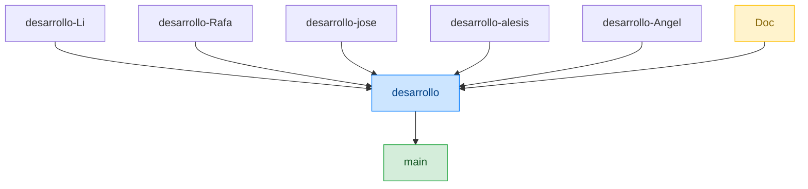

<div align="center">

# 🚀 ORBITAL 4B 🚀

### From Earth to the Moon, one trajectory at a time.

**Orbital transfer design and visualization using NASA/JPL Horizons ephemerides.**


[](https://www.spaceappschallenge.org/2026/find-a-team/oculus-terrae/?tab=project)

[Configure Your Journey](#-configure-your-journey) · [Explore the Results](#-explore-the-results) · [Getting Started](#-getting-started) · [Team](#-team)

</div>

---

## 🚨 The Mission

How can we visualize a space journey intuitively? Do we fully understand what space travel entails?

The **Terraterrestres** team presents **ORBITAL 4B**, an application that explores these questions through an intuitive visual experience built around an **Earth–Moon** transfer prototype.

## 🚨 Project Organization

### Project Branch Structure



### Branch Descriptions

| Branch | Description |
|---|---|
| `main` | Contains the stable, functional version of the product. |
| `desarrollo` | Integrates contributions from all team members. |
| `desarrollo-Li` | Li's individual development branch. |
| `desarrollo-Rafa` | Rafa's individual development branch. |
| `desarrollo-jose` | Jose's individual development branch. |
| `desarrollo-alesis` | Alesis's individual development branch. |
| `desarrollo-Angel` | Ángel's individual development branch. |
| `Doc` | Dedicated project documentation branch. |

### Workflow

1. Tasks are assigned to team members.
2. Each team member develops their assigned tasks in their `desarrollo-name` branch.
3. Once the assigned tasks are complete, the changes are integrated into `desarrollo`.
4. Documentation is maintained in `Doc` and integrated into `desarrollo`.
5. After all changes have been integrated and tested, `desarrollo` is merged into `main`, and the release is tagged.
6. The `main` branch must always contain a functional, stable product.

## 🚨 Configure Your Journey

The following parameters can be adjusted in the application:

| Option | Description |
| --- | --- |
| **Departure Date (UTC)** | The launch date. **Celestial body positions change with the selected date.** |
| **Duration (days)** | The time allocated to complete the mission. |
| **Minimum Energy** | Prioritizes the valid trajectory found that requires the least launch energy. |
| **Minimum Distance** | Prioritizes the valid trajectory found with the shortest travel distance. |

The angles specify **departure and arrival locations**, rather than the rocket's inclination.

## 🚨 Explore the Results

Select **“Calculate Transfer”** to generate a trajectory using Earth and Moon positions from NASA/JPL Horizons. You can then play back the journey, pause it, adjust the playback speed, and navigate through the timeline.

The application displays the **required departure speed and energy**, the **distance traveled**, and the **arrival error**: the distance between the calculated endpoint and the selected destination.

## 🚨 Solar System and NASA Data

You can select an **origin and destination** from the Sun, the eight planets, and the Moon, either through the selection menus or by choosing **“Select on Map”** and clicking a celestial body. The date determines their positions, the duration specifies the available travel time, and the mass is used to calculate the launch energy.

Position and velocity data are retrieved from [NASA/JPL Horizons](https://ssd-api.jpl.nasa.gov/doc/horizons.html) for the journey's date and time interval. Mean radii and gravitational parameters are obtained from the same service's body data sheets and stored, together with their source and retrieval date, in [the solar system catalog](backend/app/data/solar_bodies.json).

To improve loading performance, we download hourly samples for each day and display celestial bodies as their data becomes available. Changes in time are interpolated in the browser without additional NASA queries. Responses are cached on the server for up to seven days, including across restarts. Concurrent user requests share downloads, and access to JPL complies with its [limit of one query at a time](https://ssd-api.jpl.nasa.gov/doc/index.php).

The solar system view projects these data into 2D and compresses distances to facilitate selection; icons are enlarged. If NASA does not respond, the application displays an error without substituting fabricated positions.

**Simplified model:** the spacecraft is subject only to the gravitational attraction of the origin and destination bodies. The Sun contributes only when selected as one of these bodies. Celestial bodies follow NASA ephemerides, while the spacecraft's trajectory is calculated by our application. Arrival is defined at the destination's nominal radius, without modeling atmospheres, fuel consumption, or orbital capture. For gas giants and the Sun, this radius does not represent a solid surface.

Journeys of up to 100 years are supported, subject to Horizons coverage. The departure direction is automatically oriented toward an estimated encounter point, and the arrival angle is determined through a search. The search is time-limited and may fail to find a solution; it does not guarantee an optimal route or a physically feasible mission within the full solar system. The lunar orbit and return mode retains its 30-day limit.

## 🚨 Getting Started

You will need Python 3.10 or later, a Node.js version compatible with Vite 8, and an internet connection to retrieve NASA data.

From the project root, start the server:

```bash
cd backend
python3 -m venv .venv
source .venv/bin/activate
python -m pip install -e .
python -m uvicorn app.main:app --reload
```

In a separate terminal, start the frontend from the project root:

```bash
cd frontend
npm ci
npm run dev
```

Open **<http://localhost:5173>**. No additional environment variable configuration is required for this local setup.

📄 [Project Report](docs/main.pdf) · [Technical Documentation](backend/TRANSFER.md)

## 🚨 Team

**Terraterrestres**

- Jose Luis Parrilla Fuente
- Rafael Juan Jimenez
- Alejandro Moreno Lechado
- Yaojian Li
- Angel Olmo Saez

---

## 🚨 Use of AI

- Gemini Hydrogen 4.0: Corrections to minor logical and physics-related errors.
- ChatGPT Astra 6.0: Conflict resolution when integrating development branches and assistance with project documentation.
- ChatGPT Sol 5.5: Assistance with the presentation's visual design.
- Claude Opus 5.5: Assistance with the mathematical implementation of the trajectory function.

## 🚨 References

[Differential Equations II — Rafael Ortega, Professor at the University of Granada](https://www.ugr.es/~rortega/Ecuaciones.htm)

Numerical Methods II Course Notes — University of Granada

[JPL Horizons](https://ssd.jpl.nasa.gov/)

[NASA Trajectory Browser](https://trajbrowser.arc.nasa.gov/example_queries.php)

[NASA Planetary Data API](https://ssd.jpl.nasa.gov/api/horizons.api)

[API Documentation](https://ssd-api.jpl.nasa.gov/doc/horizons.html)
